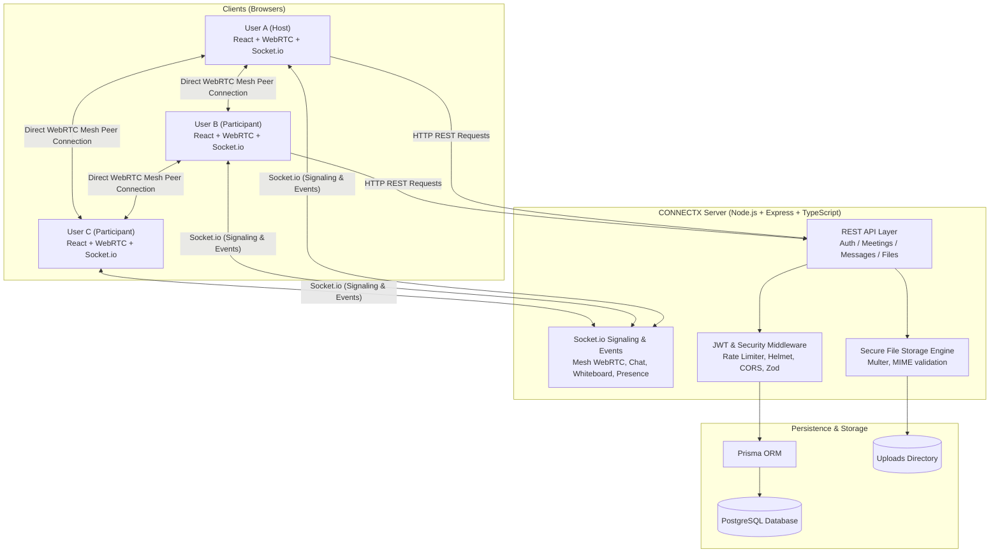
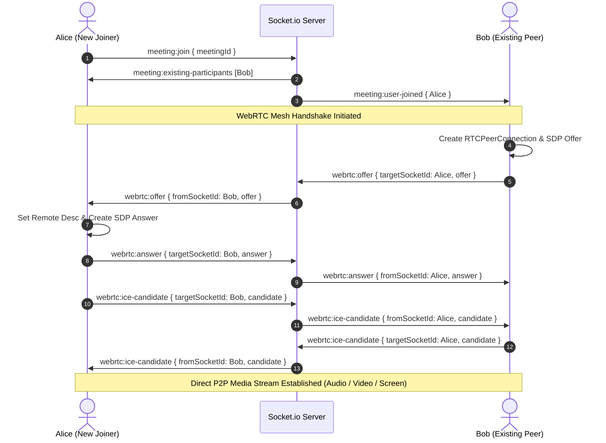

# CONNECTX — Real-Time Communication & Collaboration Platform

[](https://www.typescriptlang.org/)
[](https://reactjs.org/)
[](https://webrtc.org/)
[](https://socket.io/)
[](https://nodejs.org/)
[](https://www.prisma.io/)
[](https://tailwindcss.com/)
[](https://opensource.org/licenses/MIT)

**CONNECTX** is a production-grade, portfolio-quality real-time video conferencing, collaborative whiteboard, instant messaging, screen-sharing, and file-exchange platform built with modern WebRTC, Socket.io, React 18, Node.js, and PostgreSQL.

---

## 📸 Core Features

- 🎥 **True WebRTC Multi-Peer Mesh Video Calling**: Native `RTCPeerConnection` mesh with ICE candidate negotiation and STUN servers.
- 🎙️ **Crystal-Clear Audio & Live Activity Detector**: Real-time speaking detection using Web Audio API (`AudioContext` + `AnalyserNode`) with glowing speaker rings.
- 🖥️ **Screen Sharing**: Browser-native `getDisplayMedia` with automatic track replacement (`RTCRtpSender.replaceTrack`) without tearing down peer connections.
- 🎨 **Collaborative Whiteboard**: Synchronized vector drawing with Bezier smoothing, geometry tools (lines, rectangles, circles), color palette, stroke sizing, undo, room-wide clear sync, and PNG export.
- 💬 **In-Meeting Real-Time Chat & File Sharing**: Low-latency Socket.io messaging, database message persistence, and secure file uploads (PDFs, images, docs, archives) with size and MIME validation.
- 🔒 **Enterprise-Grade Security**: JWT authentication, bcrypt password hashing, passcode-protected meetings, room locks, Helmet headers, CORS policies, and rate limiting.
- 📱 **Responsive, Accessible Dark UI**: Minimalist, modern user interface crafted with Tailwind CSS and Lucide React.

---

## 🏛️ System Architecture



---

## 🌐 WebRTC Signaling & Lifecycle State Machine



---

## 📡 Real-Time Socket Protocol

| Event Name | Direction | Payload | Description |
| :--- | :--- | :--- | :--- |
| `meeting:join` | Client $\to$ Server | `{ meetingId, meetingCode, isMuted, isCameraOff }` | Join room & register participant |
| `meeting:existing-participants` | Server $\to$ Client | `{ participants: Participant[] }` | List of current peers in the room |
| `meeting:user-joined` | Server $\to$ Client | `{ participant: Participant }` | Broadcast new member to room |
| `meeting:user-left` | Server $\to$ Client | `{ socketId, userId }` | Broadcast member departure & clean up WebRTC |
| `webrtc:offer` | Bidirectional | `{ targetSocketId, offer }` | SDP Offer negotiation |
| `webrtc:answer` | Bidirectional | `{ targetSocketId, answer }` | SDP Answer response |
| `webrtc:ice-candidate` | Bidirectional | `{ targetSocketId, candidate }` | ICE Candidate exchange |
| `media:toggle` | Client $\to$ Server | `{ isMuted?, isCameraOff?, isScreenSharing? }` | Broadcast mic, camera, screen state |
| `chat:send` | Client $\to$ Server | `{ meetingId, content, fileId? }` | Submit in-meeting message |
| `chat:received` | Server $\to$ Client | `{ message: Message }` | Instant message delivery |
| `whiteboard:draw-stroke` | Client $\to$ Server | `{ meetingId, stroke: StrokeData }` | Broadcast vector draw step |
| `whiteboard:clear` | Client $\to$ Server | `{ meetingId }` | Clear board for all attendees |
| `whiteboard:request-state` | Client $\to$ Server | `{ meetingId }` | Sync board history for late joiners |
| `presence:speaking` | Client $\to$ Server | `{ isSpeaking: boolean }` | Real-time speech activity state |

---

## 🛠️ REST API Reference

### Authentication
- `POST /api/auth/register` — Create new user account.
- `POST /api/auth/login` — Sign in with email and password (returns JWT).
- `GET /api/auth/me` — Retrieve current authenticated user profile.
- `PATCH /api/auth/profile` — Update user profile details.

### Meetings
- `POST /api/meetings` — Create new meeting (supports title, description, passcode, room lock).
- `GET /api/meetings/my-meetings` — List hosted and attended meetings.
- `GET /api/meetings/:identifier` — Fetch meeting details by code or ID.
- `POST /api/meetings/:identifier/join` — Join meeting with optional passcode verification.
- `POST /api/meetings/:identifier/leave` — Leave meeting session.
- `POST /api/meetings/:identifier/end` — End meeting for all participants (host only).
- `PATCH /api/meetings/:identifier` — Update meeting settings (host only).

### Messages & Files
- `GET /api/messages/:meetingId` — Get message history for meeting.
- `POST /api/messages/:meetingId` — Post message (REST fallback).
- `POST /api/files/upload` — Multipart upload with MIME & size validation.
- `GET /api/files/meeting/:meetingId` — List files shared in meeting.
- `GET /api/files/download/:fileId` — Download shared file attachment.

---

## 🚀 Quick Start & Local Setup

### 1. Prerequisites
- **Node.js**: v18.0.0 or later (v20+ recommended)
- **npm**: v9.0.0 or later

### 2. Clone & Install Dependencies
```bash
git clone <repository-url>
cd "Real-Time Communication Platform"
npm install
```

### 3. Configure Environment Variables
Copy `.env.example` to `.env`:
```bash
cp .env.example .env
```

### 4. Setup Database
```bash
# Generate Prisma client
npm run db:generate

# Push schema to database
npm run db:push

# Seed demo users & meetings
npm run db:seed
```

### 5. Start Development Environment
```bash
# Launches both backend API (port 5000) and frontend Vite app (port 5173)
npm run dev
```

Visit **`http://localhost:5173`** in your browser!

---

## 🧪 Testing & Verification

Run the comprehensive test suite across both frontend and backend:
```bash
# Run all unit and integration tests
npm run test

# Run TypeScript typechecks
npm run lint

# Build production bundles
npm run build
```

---

## 🔑 Demo Accounts (Pre-configured)

| Name | Email | Password | Role |
| :--- | :--- | :--- | :--- |
| **Alex Rivera** | `alex@connectx.io` | `Password123!` | Host |
| **Sarah Chen** | `sarah@connectx.io` | `Password123!` | Participant |
| **David Kim** | `david@connectx.io` | `Password123!` | Participant |

---

## 🛡️ Security Best Practices

1. **Password Security**: Passwords are never stored in plaintext and are hashed using bcrypt with salt rounds of 12.
2. **Token Authentication**: Stateless JWTs with signature verification on all protected endpoints and WebSocket handshakes.
3. **File Security**: Uploaded files are validated against allowed MIME types, strictly size-capped (10MB), and stored with cryptographically unique identifiers to prevent directory traversal attacks.
4. **Network Protection**: Express API rate limiting against brute force and DDoS attacks, plus Helmet security headers and strict CORS origin whitelisting.

---

## 📄 License
Released under the [MIT License](LICENSE).
